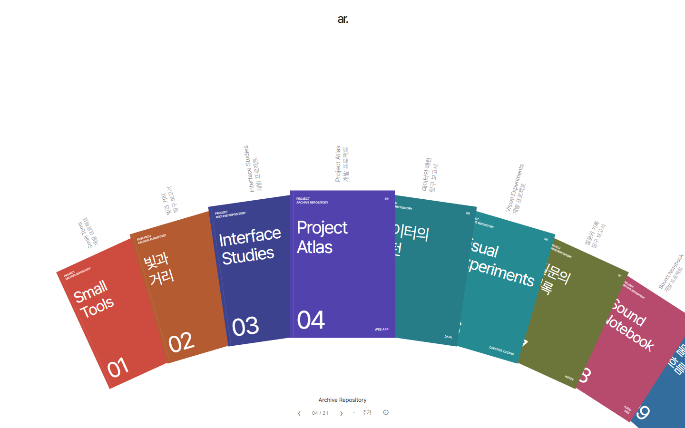
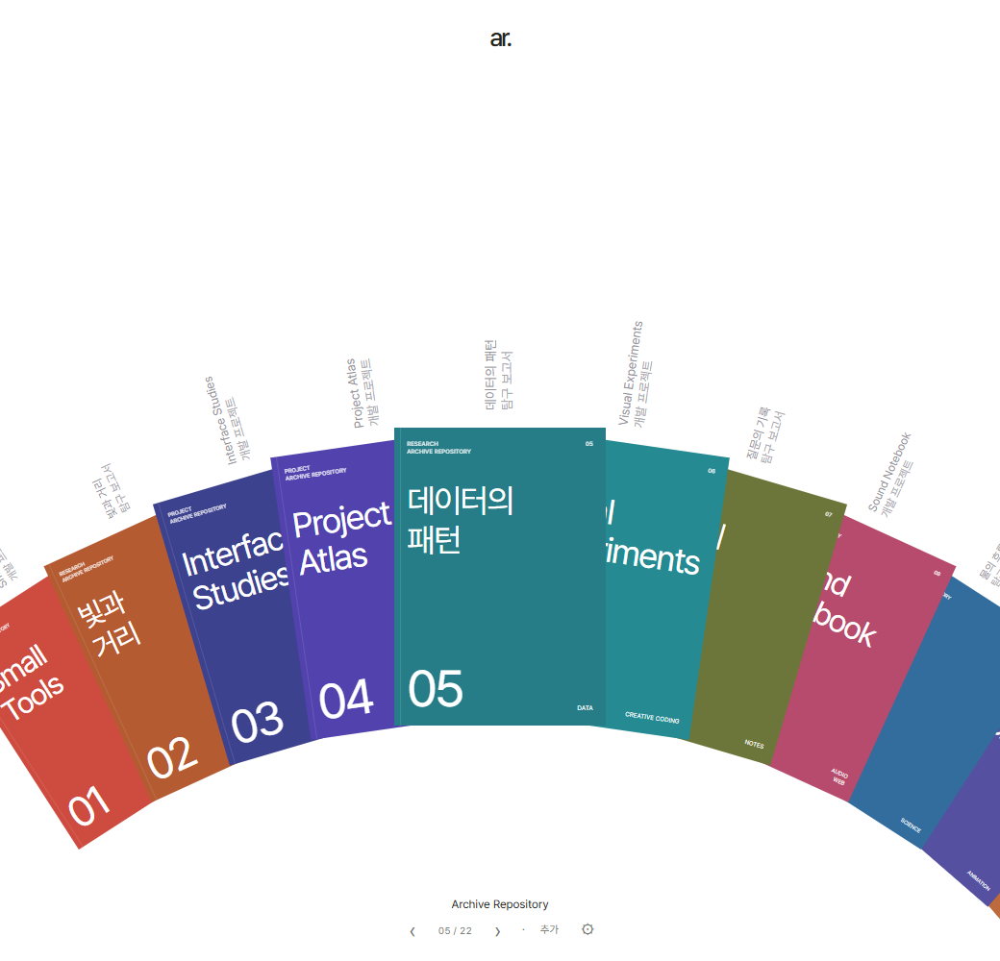
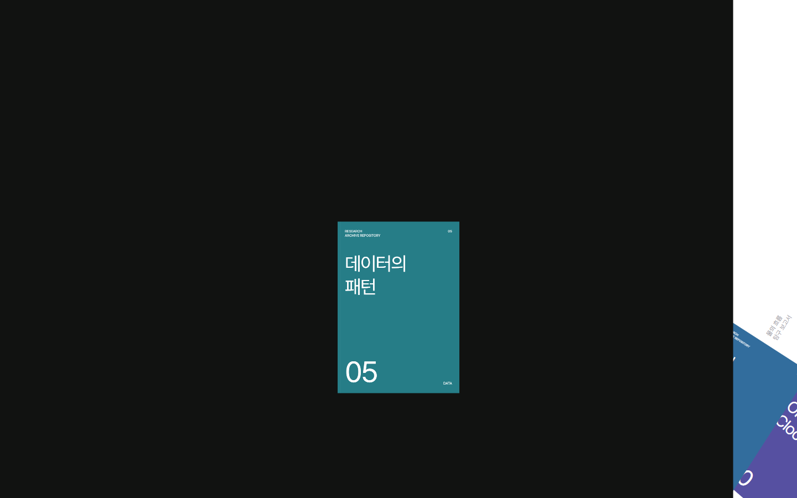
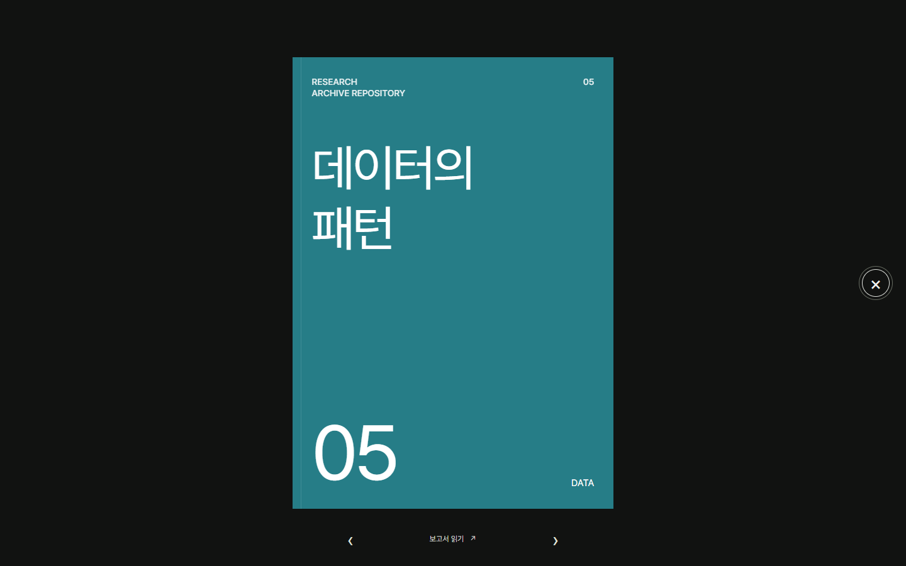
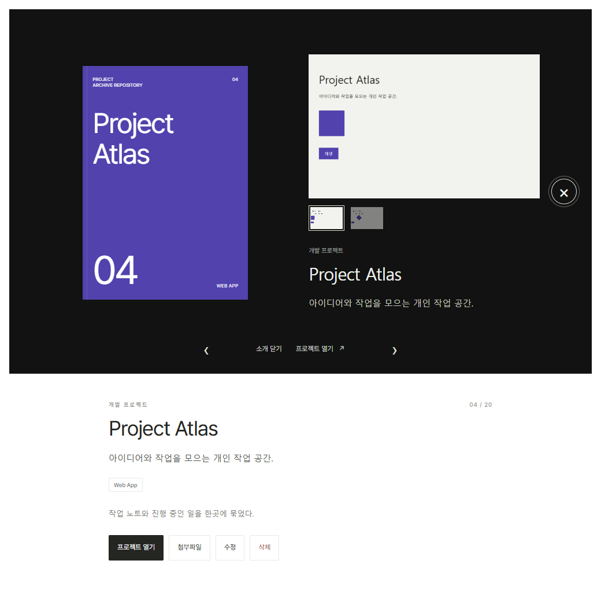
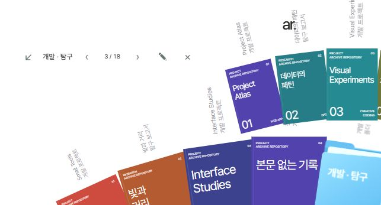
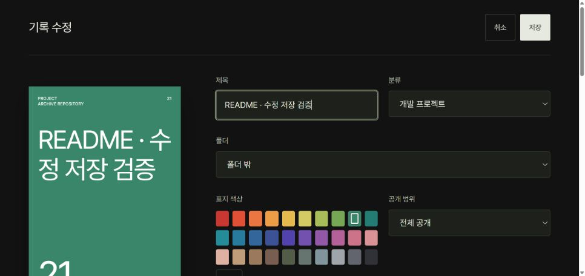
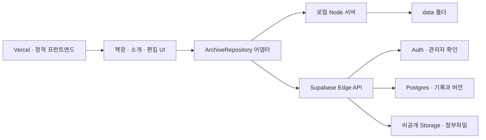

# Archive Repository

**완성한 프로젝트와 탐구 보고서를, 다시 꺼내 보고 싶은 책장으로.**

[사이트 열기](https://archive-repository.vercel.app) · [사용 가이드](docs/GUIDE.md) · [개발 일지](docs/DEVELOPMENT.md) · [실행·배포](docs/SETUP.md) · [화면 기록](docs/images/README.md)



> 위와 아래의 이미지는 개발·검증 과정에서 직접 남긴 화면입니다. 예시 프로젝트와 이전 UI가 포함되어 있으며, 현재 운영 사이트의 기록 목록이나 배치를 그대로 나타내지는 않습니다.

## 왜 만들었나

개발 프로젝트와 탐구 보고서를 함께 보관하고 싶었다. 프로젝트는 실행 사이트와 GitHub에, 보고서는 파일 안에 흩어져 있었다. 링크만 모으면 무엇을 만들었는지 설명하기 어렵고, 소개만 쓰면 실제 결과물을 다시 찾아 들어가야 했다.

그래서 **결과물에 바로 닿을 수 있는 저장소이면서, 내가 한 일을 소개할 수 있는 포트폴리오**를 만들기로 했다. 일상적으로 기록을 쌓고 공유하되, 다른 사람에게 활동을 보여 줄 때에도 정돈된 인상을 주는 것이 목표였다.

처음 떠올린 형태는 책자였다. 프로젝트 하나, 보고서 하나를 색과 제목이 있는 표지로 만들고, 펼쳐진 책장 안에서 골라 읽도록 했다. 시각적 출발점은 [Form Follows Function](https://fff.cmiscm.com/#!/main)의 원호형 책자 배치와 전환이었다. 이 프로젝트에서는 여기에 개인 기록 관리, 폴더, 소개 페이지, 파일 열람과 문서 수정 기능을 구현했다. 참고 사이트의 소스·원본 이미지를 이 저장소에 포함하지 않는다.

## 책장 안에 담은 것

- **프로젝트와 보고서** — 개발 프로젝트와 탐구 보고서를 서로 다른 종류의 기록으로 저장한다.
- **표지와 소개** — 30가지 기본색과 직접 색상 선택, 책자 번호, 소개 사진, 짧은 소개와 긴 소개를 지원한다.
- **분야별 폴더** — 파란 폴더도 책자와 같은 원호에 놓인다. 안의 책자는 한 층 위에서 펼쳐진다.
- **결과물 연결** — 웹사이트·GitHub 등 이름 있는 링크를 여러 개 등록하고, 새 탭과 내부 보기를 선택한다.
- **문서 읽기** — PDF, Markdown, 텍스트, Word, Excel, PowerPoint와 지원 미디어를 내부에서 연다.
- **문서 고치기** — 관리자에게 Word 본문·텍스트·Markdown 등의 편집과 수정 이력을 제공한다.
- **공개 범위** — 전체 공개 / 비공개 / 일부 공개(링크)를 구분한다.
- **설치와 바로가기** — 지원 브라우저의 앱 설치와 Windows 바로가기 다운로드를 제공한다.

세부 지원 범위와 제한은 [사용 가이드](docs/GUIDE.md)에 정리했다. 내부에서 웹사이트를 여는 기능은 대상 사이트의 iframe·로그인 정책을 따른다.

## 개발하면서 바뀐 화면

### 1. 목록을 책장으로 만들기

화면 위에는 여백을 남기고, 아래에는 책자들이 넓은 원호를 이루도록 했다. 표지 밖의 회색 글씨에는 이름과 분류를 담았다. 제목을 가리는 겹침, 표지가 놓이는 높이, 스크롤 이동량을 반복해서 조정했다.



스크롤을 한 번 넣고 계속 움직이는 방식보다 **입력한 만큼만 이동하는 방식**을 택했다. 원하는 책자가 보이는 위치에서 멈출 수 있어야 기록을 고르기 편했기 때문이다.

### 2. 표지에서 소개로 이어지기

표지를 누르면 원래 위치와 기울기에서 확대된 상세 화면으로 이어지고, 닫으면 책장으로 돌아간다. 다음 기록으로 이동할 때에도 좌우 방향이 느껴지도록 전환한다.

<p>
  
  
</p>

*개발 당시 전환을 시간 간격으로 확인하며 남긴 정지 화면. 애니메이션 영상은 아니다.*

초기에는 상세 아래쪽에 제목·소개·버튼이 따로 이어졌다. 다음 화면은 그때의 구현이다.



이후 중복 설명을 줄이고, **표지 옆의 같은 공간에서 짧은 소개와 긴 소개를 넘기는 구조**로 바꿨다. 표지를 다시 누르거나 ‹ / ›와 페이지 점을 사용한다. 긴 본문은 화면 폭에 맞춰 나누며 저장된 내용을 잘라내지 않는다.

### 3. 폴더도 책장에 놓기

별도 위치에 있던 폴더는 책장과 연결이 약했고, 열 때 책자가 멀리서 날아오는 느낌이 들었다. 폴더를 책자와 같은 세로 비율로 놓고, **1층의 책장은 유지한 채 폴더 안 책자를 2층에 펼치는 방식**으로 정리했다.



드래그 앤 드롭으로 넣고, 편집 화면에서도 폴더를 고른다. 폴더를 지워도 안의 기록은 남는다.

### 4. 읽기와 수정까지 연결하기

파일을 올리는 것만으로는 충분하지 않았다. PDF는 페이지 화살표를 계속 누르기보다 아래로 이어 읽을 수 있어야 했고, README를 첨부한 프로젝트는 GitHub 링크만 여는 대신 문서도 볼 수 있어야 했다.

지금은 상세 아래에 기본 문서를 자동으로 표시한다. 직접 고른 기본 첨부파일이 우선이며, 자동 선택에서는 프로젝트의 README와 보고서의 PDF를 우선한다. 외부 링크는 별도의 동작으로 유지한다.



수정 화면도 상세와 같은 어두운 배경으로 맞췄다. 왼쪽 표지는 제목과 색을 바꾸면 반영되고, 저장·취소는 스크롤 중에도 위쪽에 남는다.

**문제 → 선택 → 확인한 내용**은 [개발 일지](docs/DEVELOPMENT.md)에서 더 자세히 볼 수 있다.

## 바로 실행하기

Node.js 22 이상이 필요하다. 로컬 실행에는 Supabase 계정이 필요하지 않다.

```sh
git clone https://github.com/SbEnChOi/archive-repository.git
cd archive-repository
npm ci
npm start
```

브라우저에서 `http://127.0.0.1:4179`를 연다. 첫 실행에는 예시 기록 20개가 생성된다. 기록과 첨부파일은 로컬 `data/`에 저장되며 운영 사이트의 데이터와 분리된다. 로컬 서버는 `127.0.0.1`에만 바인딩된다. `/public`에서 방문자 화면을 확인할 수 있다.

```sh
npm test
```

클라우드 실행은 별도 설정이 필요하다. [실행·배포 가이드](docs/SETUP.md)에서 Supabase 초기화, 관리자 설정, Vercel 배포 순서를 설명한다.

## 어떻게 구성했나

프런트엔드는 바닐라 JavaScript·HTML·CSS로 만들었다. 화면은 저장소 어댑터를 통해 로컬 서버 또는 Supabase API와 연결된다. esbuild는 브라우저용 의존성을 묶고, 화면 원본은 빌드 도구가 조합한다.



- `ui/` — 책장 배치, 표지 전환, 소개 페이지, 폴더와 기록 편집
- `web/repository-adapter.js` — 로컬 저장 연결 원본
- `cloud/` — 클라우드 연결, 파일 뷰어, Office 미리보기, 문서 편집, PDF 리더
- `server.cjs` — 로컬 API와 파일 저장
- `supabase/` — 테이블·RLS·비공개 버킷 마이그레이션과 Edge API
- `assets/` — 로고, 매니페스트와 서비스 워커
- `tools/` — 로컬·클라우드 빌드, 아이콘 생성, 이전 보조 도구
- `tests/` — 권한·공개 범위·업로드·문서·PDF·Office·기록 선택 검증

PDF는 PDF.js, Markdown은 marked와 DOMPurify, Word 미리보기는 mammoth를 사용한다. Office ZIP 처리와 문서 보존에는 fflate를 사용한다.

## 기록을 다루면서 지킨 기준

비공개 기록은 파일만 가리는 것으로 끝내지 않았다. 공개 목록에서 제목·표지·개수도 노출하지 않도록 하고, 파일 게이트웨이가 요청마다 접근 권한을 확인하도록 했다. 일부 공개 기록은 공유 링크를 통해 열며, 비공개로 전환하면 이전 공유 링크의 새 요청을 차단한다.

저장에는 기록 버전을 사용한다. 오래 열린 편집 화면이 새 내용을 덮어쓰는 경우를 막고, 파일 교체와 문서 이력에도 같은 기준을 적용한다. 서비스 워커는 기록·파일·인증 정보를 캐시하지 않는다.

공개 소스에는 실제 기록, 업로드 파일, `.env.cloud`, 인증 토큰, 관리 키를 포함하지 않는다. 마이그레이션과 테스트의 관리자 이메일은 예시 값이다.

## 확인한 것과 남은 한계

2026-11-03 공개 준비 시 새 체크아웃에서 의존성 설치, 로컬·클라우드 빌드, 자동 테스트 **34개**를 통과했다. 자동 검사는 API 권한과 공개 범위, 업로드 검사, 버전 충돌, 폴더 이동, 문서 수정 보존, PDF 렌더링, Office 파싱, README 우선 선택 등을 다룬다. 화면 이미지는 개발 과정의 관찰 자료이며, 자동 테스트 결과를 대신하지 않는다.

- 업로드는 현재 요청당 합계 **50 MB**다. 1 GB 확대는 구현 완료 항목이 아니다.
- 텍스트 미리보기는 **5 MB**, Office 미리보기는 **10 MB**까지다.
- Word 편집은 본문 텍스트 중심이다. Word 전체 서식 편집기나 실시간 공동 편집기가 아니다.
- Excel·PowerPoint 미리보기는 표·문단 중심이며 원본 프로그램의 모든 배치를 재현하지 않는다.
- 외부 사이트의 로그인이나 iframe 제한은 이 사이트에서 해제할 수 없다. 이런 링크는 새 탭을 사용한다.
- 브라우저와 기기에 따라 앱 설치 방식이 다르며, 바로가기 파일 이동은 사용자가 수행한다.

## 참고와 제작 기록

디자인 참고: [Form Follows Function](https://fff.cmiscm.com/#!/main). 글꼴: [Pretendard](https://github.com/orioncactus/pretendard). 의존 라이브러리의 라이선스는 각 패키지를 따른다.

프로젝트의 목적, 화면 피드백, 기능 우선순위는 제작자가 정했다. AI 코딩 도구는 구현·오류 분석·테스트·문서 정리를 도왔다. 이 개발 일지는 대화에서 결정한 방향과 저장된 소스·검증 자료를 바탕으로 정리했으며, 당시 남기지 않은 성능 수치나 사용 성과를 추가하지 않았다.
