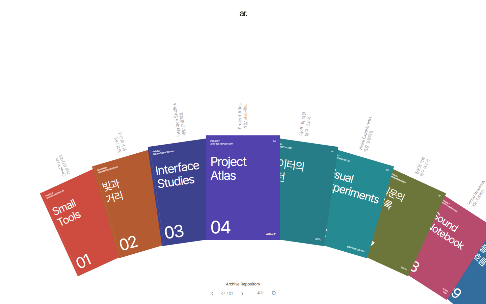
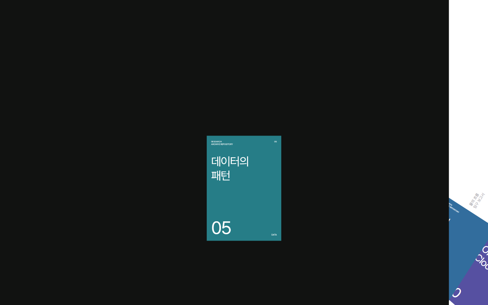
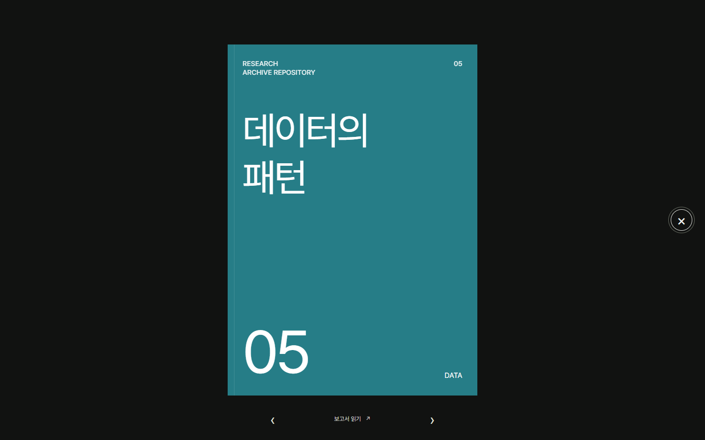
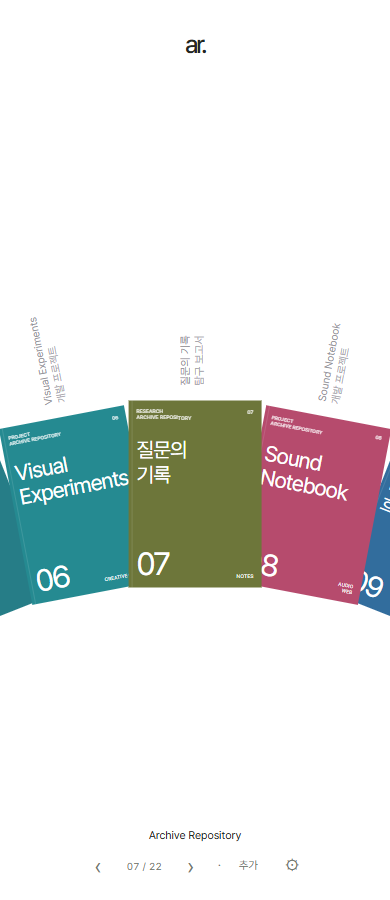
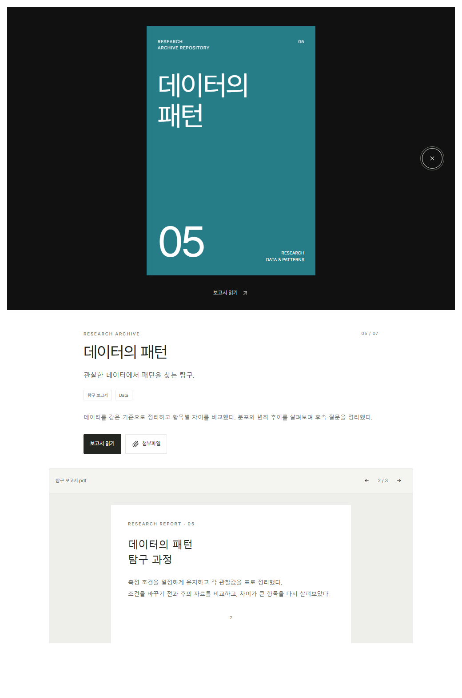
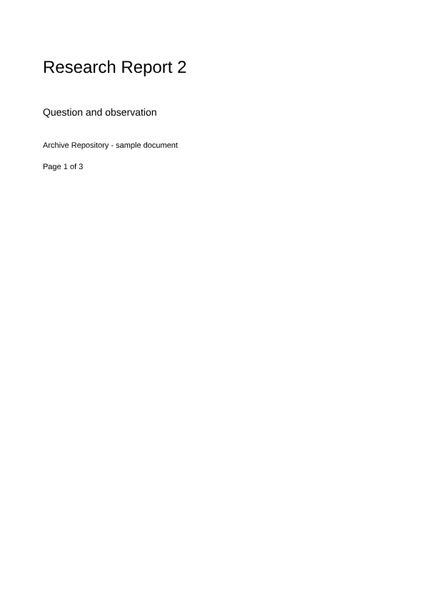
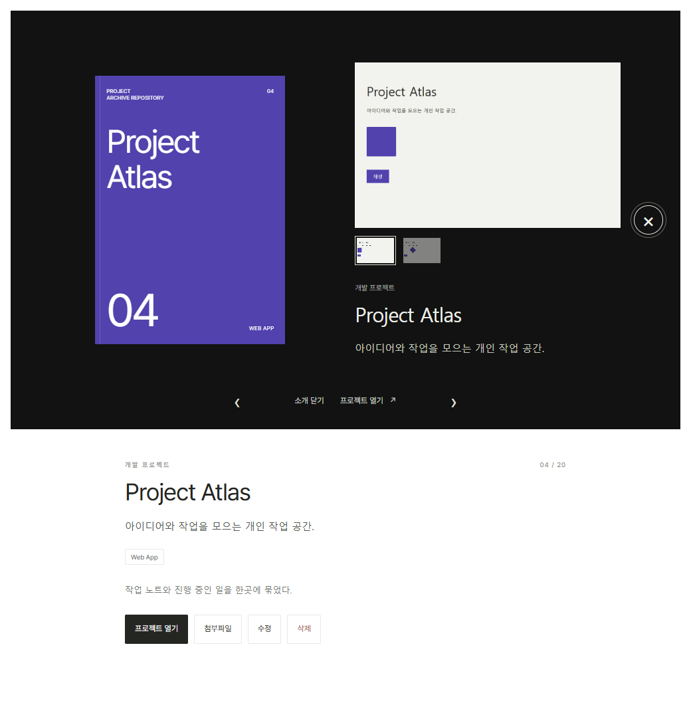
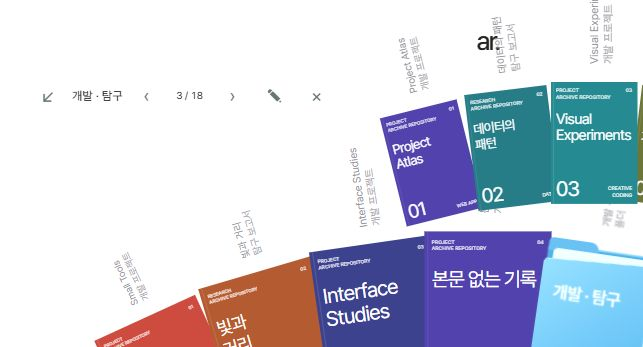
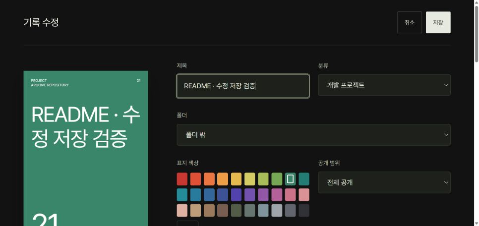

# 개발 일지 — 책장을 고치는 과정

[README](../README.md) · [사용 가이드](GUIDE.md) · [화면 목록](images/README.md)

이 글은 대화에서 정한 방향, 설계 메모, 남아 있는 구현과 검증 화면을 바탕으로 재구성했다. 날짜는 확인 가능한 개발 단계를 묶는 기준이며, 각 이미지의 정확한 촬영 시각을 뜻하지 않는다. 이미지는 샘플 데이터로 만든 개발 화면이고, 이전 UI도 포함한다.

## 2026-10-19 · 무엇을 모을 것인가

출발점은 개인 포트폴리오였다. 하지만 목적을 구체화하면서 일반적인 소개 홈페이지보다는 아카이브에 가까워졌다. 담고 싶은 것은 개발 프로젝트와 탐구 보고서였다. 이미 완성한 프로젝트는 링크로 다시 접속하고, 보고서는 사이트 안에서 읽고 싶었다. 여기에 직접 쓴 소개가 붙어야 다른 사람도 작업의 의미를 이해할 수 있었다.

그래서 한 기록에 표지, 분류, 짧은 소개, 긴 소개, 링크와 첨부파일을 연결하는 구조를 택했다. 기록과 공유가 중심이지만 활동 소개로 보여 줄 때도 완성도가 있어야 했다.

### 책자의 위치가 곧 인상이었다

[Form Follows Function](https://fff.cmiscm.com/#!/main)의 원호형 책자 구성에서 방향을 잡았다. 처음부터 복잡한 대시보드를 만들기보다, 표지의 색과 제목으로 결과물을 구분하고 화면 위에는 여백을 남겼다.

조정할 것은 많았다. 표지가 너무 겹치면 제목이 가려졌고, 원호가 위에 있으면 참고했던 책장의 인상과 달라졌다. 책자를 아래로 내리고 간격과 곡률을 조정했다. 표지 위의 회색 이름·분류는 책장 전체를 설명하는 장식 문장 대신 각 기록을 알아보는 단서가 됐다.

글꼴은 Pretendard로 통일했다. 화면에는 제목, 분류, 실제 소개와 조작 이름을 우선하고, 기능을 다시 설명하는 문장을 쌓지 않는 원칙을 세웠다.

### 표지가 장면을 이어 주도록

클릭한 책자가 다른 화면에서 갑자기 나타나면 책장과 상세가 끊겨 보인다. 선택한 책자의 위치와 기울기에서 커지고, 닫을 때에는 돌아가는 전환이 필요했다. 좌우 기록 이동에도 방향을 반영했다.

  
  

*전환을 검토하면서 남긴 서로 다른 시점의 정지 이미지다.*

휠 이동도 입력한 만큼만 반영하도록 정리했다. 화면의 움직임 자체보다 원하는 기록 앞에서 멈출 수 있는지가 중요했다. 모바일에서는 원호를 유지하면서 스와이프와 화살표로 접근하도록 했다.

## 2026-10-21 · 보관할 수 있는 사이트로

### 로컬과 운영을 나누기

초기 화면이 동작한 뒤에는 실제 기록을 저장하고 다시 읽는 흐름을 붙였다. 로컬은 Node 서버와 파일 기반 저장을 사용하고, 운영은 Vercel의 정적 프런트엔드와 Supabase의 Auth·Postgres·Storage를 사용했다.

같은 UI가 저장 방식에 직접 묶이지 않도록 `ArchiveRepository` 어댑터를 경계로 두었다. 덕분에 로컬 예시와 테스트를 운영 기록과 분리할 수 있었다.

### 공개 범위는 목록에서도 지켜야 했다

전체 공개, 비공개, 링크를 가진 사람만 보는 일부 공개를 구분했다. 비공개 파일을 막아도 목록에 제목과 개수가 보이면 기록의 존재가 드러난다. 목록과 파일 접근을 함께 확인해야 했다.

기록은 보호된 테이블에, 파일은 비공개 버킷에 저장한다. 브라우저는 API를 통해 접근하고, API가 관리자 인증과 기록별 공개 범위를 판단한다. 파일 게이트웨이도 요청마다 권한을 검사한다. 링크로 공유한 기록을 비공개로 바꾸면 이전 링크로 들어오는 새 요청이 차단되는지 검사했다.

### 외부 사이트와 파일은 다른 방식으로 읽기

프로젝트는 실행 사이트와 GitHub 주소를 각각 등록할 수 있도록 이름 있는 링크를 지원했다. 링크별 열기 방식도 선택한다. 외부 서비스의 인증은 iframe 안에서 정상적으로 이어지지 않을 수 있어 새 탭으로 여는 경로를 남겼다.

보고서는 원본을 사이트 안에서 읽는 방향으로 발전시켰다. 초기에는 아래 그림처럼 페이지 화살표가 중심이었다.

*이 이미지는 초기 구현 기록이다. 현재 PDF 리더는 세로 연속 읽기를 사용한다.*

이후 PDF.js로 원본 페이지를 세로로 이어 배치했다. 화면 가까이 있는 페이지를 우선 렌더링하고 멀리 벗어난 캔버스는 해제한다. 다음 장을 읽을 때마다 버튼을 눌러야 했던 동작을 줄였다.

*테스트용 PDF의 한 페이지를 렌더링한 결과. 실제 개인 보고서가 아니다.*

## 2026-10-21~22 · 소개와 폴더를 다시 배치하기

### 긴 소개를 다른 창으로 보내지 않기

표지 옆의 짧은 소개는 보기 편했지만, 긴 소개를 다른 흰 창이나 아래쪽 영역으로 옮기면 읽는 위치가 바뀌고 답답하게 느껴졌다. 아래 이미지는 표지 옆 소개와 아래 설명이 함께 있던 단계다.

최종 방향은 단순했다. 처음에는 짧은 소개, 한 번 더 누르면 긴 소개를 **같은 위치**에 보여 주는 것이다. ‹ / ›와 점으로 넘기고, 이동 방향에 맞춰 슬라이드와 페이드를 적용했다.

본문을 임의로 자르지 않도록 표시 폭과 높이에 맞춰 페이지를 계산한다. 화면 크기 변경, 마지막 문단, 긴 제목, 링크의 키보드 초점처럼 눈에 잘 드러나지 않는 경우도 함께 확인했다.

### 폴더는 별도 아이콘이 아니라 책장의 한 항목

분야별 분류를 위해 파란 폴더를 추가했다. 처음에는 위치와 비율이 책자와 어울리지 않았고, 열 때 내부 책자가 멀리서 날아오는 느낌이 있었다.

해결 방향은 ‘층’이었다. 현재 원호를 1층으로 보고, 폴더 안 책자는 그 폴더 위의 2층에서 펼친다. 폴더를 열어도 1층의 위치를 유지해야 다른 항목이 마우스 아래로 밀려오지 않는다.

폴더는 세로형으로 맞추고, 바깥 원호의 좌표 계산과 폴더 덮개·내부 표지 애니메이션을 분리했다. 열기, 고정, 책자 이동, 상세 열기 후 돌아오기, 드래그로 넣고 빼기를 확인했다. 비어 있는 폴더와 폴더 삭제 후 기록 유지도 검증 대상이었다.

## 2026-10-22 이후 · 읽기 버튼 앞에서 멈추지 않도록

상세 아래의 문서가 읽기 버튼을 눌러야 나타나면, 처음 방문한 사람은 더 내려갈 내용이 없는 것으로 받아들일 수 있다. 읽기·첨부파일·수정 버튼도 아래쪽에 있어 접근하기 어려웠다.

그래서 동작을 나누었다. 기본 문서는 상세를 열 때부터 아래에 표시하고, 읽기 버튼은 그 문서로 바로 이동하는 역할을 한다. 버튼은 책자 옆 소개 영역에 모았다. 작은 화면에서는 소개 내용보다 위에 둔다.

또 README를 첨부했는데도 프로젝트 열기가 GitHub 링크만 여는 문제가 있었다. 첨부 문서 선택과 명시적으로 누른 외부 링크를 분리했다. 자동 선택에서는 README를 우선하고, GitHub 링크는 그대로 별도로 열리게 했다. README 안의 상대 경로 문서와 사진도 연결된 GitHub 저장소를 기준으로 해석한다. 위험한 URL과 스크립트는 허용하지 않는다.

수정 화면은 어두운 상세와 같은 분위기로 맞췄다. 색과 제목을 바꾸면 표지에서 바로 확인할 수 있고, 저장·취소는 화면 위에 남는다.

## 소스 공개 정리 · 2026-11-03

공개용으로 현재 코드를 다시 확인하면서 책자 번호 지정, 기본 첨부파일 선택, Office 내부 미리보기도 문서에 반영했다. 이 기능들의 정확한 최초 구현일은 이 일지에서 추정하지 않았다.

실행 가이드를 따라 다른 컴퓨터에서도 빌드할 수 있도록 개인 PC에 고정된 미리보기 경로를 프로젝트 내부 `output/preview.html`로 바꿨다. 실제 기록과 첨부파일, 환경변수, 인증 정보, 생성 번들과 내부 작업 메모는 공개 대상에서 제외했다. 초기화용 관리자 이메일과 테스트 데이터의 이메일은 예시 값으로 정리했다. 운영 DB의 관리자 설정을 변경한 것은 아니다.

## 이 과정에서 남은 기준

좋아 보이는 전환과 실제로 편한 읽기는 별개였다. 표지를 멋지게 여는 것만으로는 긴 소개, 첨부파일, 수정 동작이 해결되지 않았다. 쓰면서 발견한 불편을 기준으로 위치와 동작을 다시 바꾸는 과정이 이 프로젝트의 중심이었다.

현재 자동 검사는 권한, 공개 범위, 버전 충돌, 문서 보존, PDF 렌더링과 Office 파싱 등을 다룬다. 화면과 실제 입력은 따로 확인했다. 이 기록은 전체 기기에서 오류가 없다는 보증이나 서비스의 성과 측정이 아니다.

다음 과제는 큰 첨부파일 전송과 더 넓은 문서 호환성이다. 1 GB 업로드는 현재 완료된 기능이 아니다. Word·Excel·PowerPoint의 미리보기도 원본 프로그램의 모든 표현을 대신하지 않는다. 구현한 범위를 분명하게 남기는 것까지 아카이브의 일부로 보고 있다.
