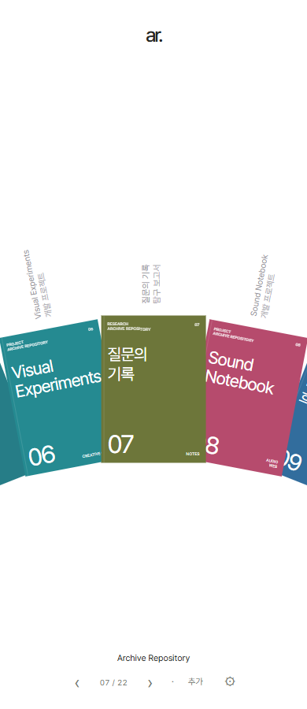
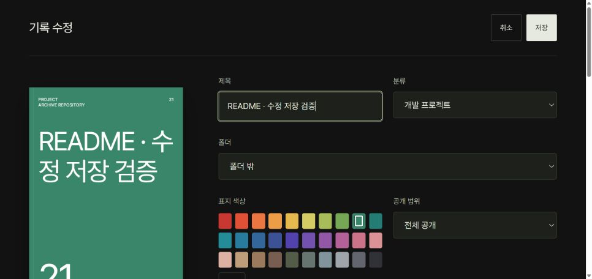
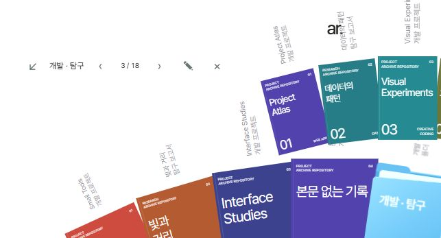

# 사용 가이드

[README로 돌아가기](../README.md) · [실행·배포](SETUP.md)

## 기록 둘러보기

책장을 스크롤하거나 아래쪽 화살표로 이동한다. 마우스를 올리면 미리보기를 확인할 수 있다. 책자를 누르면 표지와 소개가 열린다. 닫기를 누르면 책장으로 돌아간다.

*개발 당시 모바일 예시 화면. 실제 기록 내용과 현재 배치는 다를 수 있다.*

표지를 다시 누르면 긴 소개로 이동한다. 소개의 ‹ / ›와 점으로도 페이지를 넘긴다. 본문은 같은 공간 안에서 페이지로 나뉜다. 책자 사이 이동 화살표와 소개 페이지 화살표는 서로 다른 동작이다.

## 기록 추가와 수정

운영 사이트는 설정의 로그인에서 관리자 이메일로 인증한다. 확인된 관리자만 추가·수정·삭제할 수 있다. 방문자는 공개 기록과 허용된 공유 링크를 읽는다.

1. 책장 아래의 **추가**를 누른다.
2. 제목과 개발 프로젝트/탐구 보고서 분류를 정한다.
3. 폴더, 책자 번호, 표지 색과 공개 범위를 선택한다.
4. 짧은 소개, 소개 사진과 긴 소개를 작성한다.
5. 이름 있는 링크와 첨부파일을 추가한다.
6. 아래에 표시할 기본 첨부파일을 고르거나 자동 선택으로 둔다.
7. **저장**한다.

30가지 색 중에서 고르거나 🎨로 다른 색을 지정한다. 소개 사진은 JPG·PNG·WebP를 최대 8장까지 넣는다. 책자 번호를 비우면 표지 순서대로 자동 부여한다. 수정 화면의 저장·취소는 상단에 남는다.

링크는 최대 10개다. 이름과 주소를 입력하고 열기 방식을 선택한다. ‘소개에 넣기’를 사용하면 짧은 소개에 `[이름](https://주소)` 형태의 링크가 들어간다. 웹사이트와 GitHub를 각각 등록할 수 있다.

## 프로젝트와 파일 열기

기본 첨부 문서는 상세 아래에 바로 나타난다. 버튼을 먼저 누르지 않아도 아래로 스크롤해 읽을 수 있다. 자동 선택에서는 개발 프로젝트의 README, 탐구 기록의 PDF를 우선한다. 소개 사진은 기본 문서 선택에서 제외한다.

첨부파일 버튼으로 목록을 펼치거나 파일 뷰어의 선택기로 다른 파일을 연다. 파일별 다운로드도 제공한다. Markdown의 상대 경로는 연결된 GitHub 저장소를 기준으로 연결하며, 해당 원격 파일이 존재해야 한다.

지원하는 내부 열람 형식은 PDF, Markdown, 텍스트·CSV·JSON, JPG·PNG·WebP, 지원 오디오·비디오, `.docx`, `.xlsx`, `.pptx`다. Office 미리보기는 문서 내용 중심이다. `.doc`, `.xls`, `.ppt`, HWP 등 지원하지 않는 형식은 다운로드한다.

외부 프로젝트는 설정과 링크별 옵션에 따라 새 탭 또는 내부 뷰어로 연다. 외부 서비스의 로그인 단계가 되돌아오거나 표시가 차단되면 **새 탭**을 선택한다. 연결된 서비스 자체의 접근 권한은 그대로 적용된다.

## 분야별 폴더

폴더 만들기로 이름을 정한다. 파란 폴더 위에 마우스나 키보드 초점을 두면 내부 책자가 위층에 펼쳐지고, 클릭하면 열린 상태를 유지한다.

책자를 폴더 위로 끌어 넣거나 수정 화면의 폴더 선택을 사용한다. 폴더 밖으로 이동할 수도 있다. 폴더를 삭제해도 책자 자체는 삭제하지 않는다. 방문자에게는 공개 책자가 있는 폴더만 나타난다.

## 공개 범위와 공유

- **전체 공개**: 공개 목록과 상세에서 읽을 수 있다.
- **비공개**: 관리자만 볼 수 있다. 공개 목록에 제목이나 개수를 포함하지 않는다.
- **일부 공개 · 링크**: 공유 링크를 가진 사람이 열 수 있다. 일반 공개 목록에는 나오지 않는다.

링크 복사로 기록을 공유한다. 링크를 전달받은 사람이 다시 전달할 수 있다는 점을 고려해 자료를 선택한다. 비공개로 바꾸면 이전 공유 링크를 통한 새 요청은 차단된다. 이미 내려받은 파일을 회수하는 기능은 없다.

## 첨부 문서 수정

관리자는 첨부파일 목록의 **편집**을 사용한다. Word 본문, 텍스트·Markdown·CSV·JSON을 지원한다. 텍스트 편집은 2 MB, Word는 압축 10 MB/확장 64 MB 제한을 적용한다. PDF와 Office 미리보기 지원이 모든 형식의 편집 지원을 뜻하지는 않는다.

Word의 이미지·스타일·표 구조를 유지하며 본문 텍스트를 고친다. 필드나 변경 추적 등 편집이 제한된 문단도 있다. 원본과 최근 네 개의 이전 수정본을 유지하고, 이전 내용을 불러와 저장하면 새 수정본이 된다. 이력은 관리자만 볼 수 있다.

다른 화면에서 먼저 수정한 기록과 버전이 충돌하면 저장이 거절될 수 있다. 새로고침 전에는 작성 중인 내용을 따로 보관하고 최신 기록을 확인한다.

## 앱 설치와 바로가기

설정의 앱 설치는 지원 브라우저가 제공하는 설치 확인창을 연다. 바로가기 다운로드는 현재 사이트를 여는 Windows `.url` 파일을 만든다. 다운로드한 파일을 바탕화면으로 옮긴다. 오프라인에서 모든 기록과 첨부파일을 읽는 기능은 제공하지 않는다.

## 파일 크기

한 번에 올리는 파일과 사진의 합계는 50 MB다. 텍스트 미리보기는 5 MB, Office 미리보기는 10 MB까지다. 1 GB 직접 업로드는 현재 지원하지 않는다. 큰 파일은 외부 저장소에 두고 관련 링크를 등록하는 방법을 사용할 수 있다.
